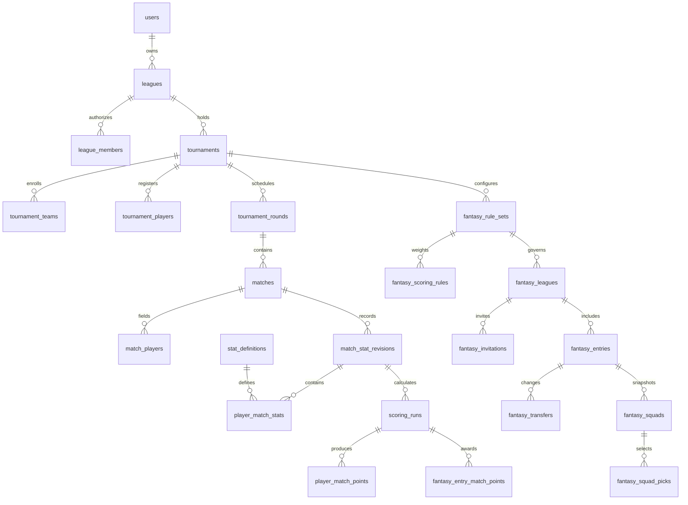

# Local cricket fantasy database design

Status: schema-first implementation, 2026-11-16. PostgreSQL + Drizzle.

## Product model

A **league** is the organizer-owned local cricket competition (for example,
Kathmandu Community Cricket). A **tournament** is one edition/season of it. A
**fantasy league** is an invite-based fantasy competition over that tournament;
several fantasy leagues may use the same real fixtures and player statistics.

Users may organize, score and play. Real players are separate people/records
from fantasy users and need not have login accounts. Cricket is the first sport.
League sport and metric definitions leave room for other sports; existing
cricket player roles remain for backwards compatibility.

A manager keeps a squad across the tournament. Each round has a deadline and an
immutable squad snapshot. Transfer usage is the number of committed transfer
records across the entire tournament entry. It does not reset each round.
Initial selection is not a transfer; editing an unlocked initial draft is free.

## Entities and ownership

| Capability | Tables | Purpose |
| --- | --- | --- |
| Identity | users | Existing accounts; credentials never appear in read APIs |
| League administration | leagues, league_members | Real league, owner, scoped organizer/scorer permissions |
| Tournament | tournaments, tournament_teams, tournament_players, tournament_rounds | Season, enrolled teams, eligible player roles/prices and deadlines |
| Fixtures | matches, match_players | Schedule and confirmed participants for each fixture |
| Statistics | stat_definitions, match_stat_revisions, player_match_stats, cricket_innings, match_results | Sport metrics, draft/published submissions, numeric observations |
| Fantasy policy | fantasy_rule_sets, fantasy_scoring_rules | Versioned budget/selection/transfer policy and metric weights |
| Fantasy competitions | fantasy_leagues, fantasy_invitations, fantasy_entries | Invite groups and one manager entry per competition |
| Squads | fantasy_squads, fantasy_squad_picks, fantasy_transfers | One snapshot per entry/round, picks and tournament transfer history |
| Scoring | scoring_runs, player_match_points, fantasy_entry_match_points | Versioned calculations and attributable fantasy totals |

## Integrity and historical correctness

- UUID primary keys; UTC `timestamptz` for new event timestamps. The tournament
  stores an IANA timezone for local schedule display.
- Composite foreign keys carry tournament IDs through registrations, fixtures,
  entries, snapshots and calculations, preventing cross-tournament references.
- A team/player may enter several tournaments. Role, price and availability
  belong to the tournament registration, not only the legacy player record.
- Match numbers and round numbers are unique within a tournament. Teams must
  differ. Participants must be registered in the tournament.
- Prices, budgets and points use exact decimal types. Numeric values are strings
  in Drizzle by default; do arithmetic with decimal-safe code, never floats.
- One player per squad, one slot per squad, at most one captain and vice captain.
  A pick cannot be both. A transfer must change the player.
- Invitations store a hash of a cryptographically random token, not the raw
  token. Expiry and revocation are represented; delivery is a later workflow.
- One entry per user/fantasy league; one squad snapshot per entry/round;
  transfer request keys and calculation keys make retries deduplicatable.
- Cricket scorecards store innings totals, wickets, extras and **legal balls**,
  not decimal overs, plus a revisioned match outcome/winner for standings.
  Net run rate and tournament table tie-breaks remain configurable application policy.
- Submitted statistics have a revision number and draft/published status. A
  correction creates a new complete revision; do not mutate published history.
  Each metric has one value per participant/revision. Missing is not zero.
- Rule sets have explicit versions. Published/used versions are immutable at the
  application boundary. Scoring rules initially support metric weights and
  optional thresholds; a future engine must define cricket bonuses explicitly.
- Each scoring run names its stat revision, rule set and engine version. A partial unique key allows at most one `is_current` run per match/fantasy
  league; it must be completed. Only current completed runs for the current
  published revision count toward standings;
  never sum every historical recalculation.
- Derived per-player and per-entry scores retain their calculation provenance.
  Tournament statistics aggregate published observations (runs, wickets,
  catches, balls, etc.), independently of fantasy scoring weights.
- No destructive cascading deletion of tournament/score history. Archive real
  competitions and deactivate memberships/registrations instead.

## Required application transactions

The database constrains references and simple row invariants. These multi-row
policies require application operations and tests when their APIs are built:

1. **Join by invitation:** lock invitation; check expiry/revocation and target
   email when present; create entry once. Organizer identity and invite access
   must be checked by guards/services.
2. **Save or transfer squad:** lock entry; enforce deadline, configured squad
   and lineup counts, budget, role/team limits, player eligibility; count all
   tournament transfer records against the rule-set allowance; write picks and
   transfer records together. Serialize concurrent transfers using the entry
   row lock. A future round inherits the last locked squad before transfers.
3. **Lock round:** materialize one snapshot per active entry and freeze it.
   A player transfer to a real team must not rewrite old registrations/snapshots.
4. **Publish stats:** verify league scorer permission and participant team is one
   of the match's two teams; verify metric sport/units, input bounds and match
   completeness; freeze the revision and mark previous publication superseded.
5. **Score:** use one published revision, a locked squad matching the fixture's
   round and an immutable rule set; include only starting/eligible picks and
   configured captain rules; write player/entry results and complete the run
   atomically. Serialize the active-run pointer per match/competition so stale
   workers cannot replace newer corrections. Recompute from source on correction.

These workflows are a blueprint, not implemented business APIs or a functioning
points engine. Aggregate squad size/budget/transfer rules cannot be enforced by
ordinary SQL CHECK constraints alone. Owners/scorers need authorization before
any tenant data is exposed; legacy list endpoints are still global compatibility
reads and must be replaced/scoped before a multi-tenant public launch.

## Compatibility and migration

Keep existing users, teams, players and matches. New tournament fields on old
fixtures are nullable so existing rows need no fabricated organizer/season.
New fixtures must supply tournament and round together. New composite keys
restrict them to enrolled teams. Existing match-number uniqueness becomes
per-tournament, with a partial unique index preserving legacy numbering.
Existing global team name/code uniqueness remains a compatibility limitation:
independent leagues should reuse a real team identity or use distinct codes;
relaxing it needs a later API/seed migration and an explicit identity policy.
Legacy player team/price/role fields are retained for existing API consumers;
new fantasy selection uses tournament registrations. Imported historical legacy
matches are excluded from new tournament workflows until explicitly assigned.

Use generated, inspected migrations; never schema push or automatic startup
synchronization on production. Inspect existing target data before applying.
Rehearse the full migration chain in an isolated PostgreSQL namespace. The old
role-renaming migration requires a data mapping if legacy long-name roles exist.
Deploy application code compatible with both old and expanded data first. A
rollback may require forward repair; do not drop populated new tables casually.

## Checkpoint after the schema

Next implement authenticated league/tournament registration, invitations,
fixture/round management, validated stats entry, squad/transfer transactions,
then scoring and leaderboard reads. Confirm exact cricket rules before shipping
those workflows. No assumed FPL budget or transfer number is baked into the model.
